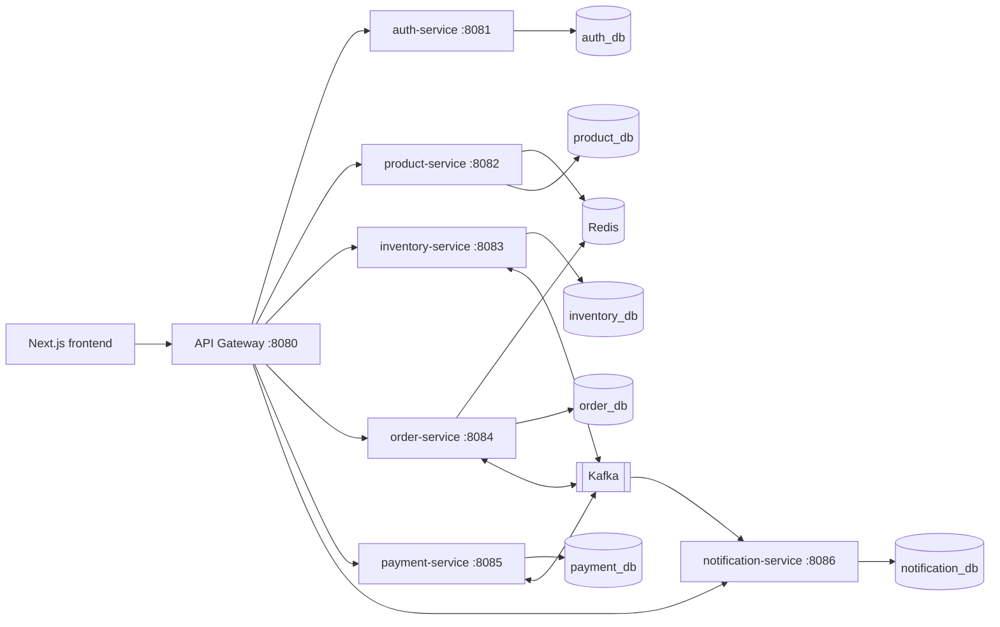
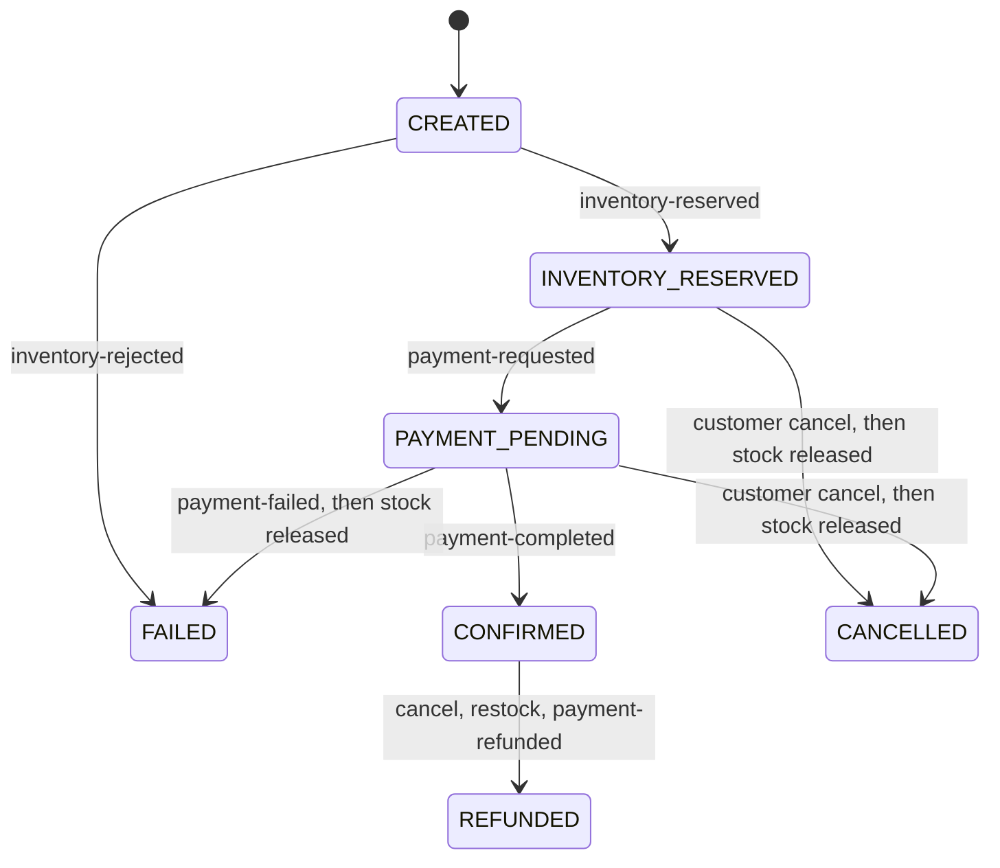

# Architecture

This is the design agreed in Phase 1. Sections marked *planned* are not implemented yet; the
README's status table is the source of truth for what runs today.

## Service boundaries



| Service | Port | Database | Owns |
| --- | --- | --- | --- |
| api-gateway | 8080 | none | Routing, edge JWT check, CORS, error mapping, correlation IDs |
| auth-service | 8081 | `auth_db` | Users, roles, BCrypt hashes, profiles, token issuance |
| product-service | 8082 | `product_db` | Categories, products, search, Redis read cache |
| inventory-service | 8083 | `inventory_db` | Stock levels and per-order reservations |
| order-service | 8084 | `order_db` | Carts, orders, items, and order status. Redis caches the cart |
| payment-service | 8085 | `payment_db` | Simulated charges and refunds. Does not write order status |
| notification-service | 8086 | `notification_db` | Stored email records. No mail is sent |

Rules:

- One database per service. No cross-database joins or foreign keys. Flyway owns each schema.
- Services never read another service's tables. Data crosses boundaries through REST or Kafka events.
- REST APIs return DTOs, never JPA entities.

## Authentication model

```mermaid
sequenceDiagram
  participant B as Browser
  participant G as API Gateway
  participant A as auth-service
  participant S as Any service
  B->>G: POST /api/auth/login
  G->>A: forward (public route)
  A-->>B: HS256 JWT {sub=userId, email, roles}
  B->>G: GET /api/orders (Authorization: Bearer)
  G->>G: verify signature, expiry, issuer, roles; ADMIN for /api/admin/**
  G->>S: forward with same Authorization + X-Correlation-Id
  S->>S: verify token again, apply resource rules
```

- Tokens are signed with a shared HMAC-SHA256 key from `JWT_SECRET` (at least 32 bytes).
- The gateway rejects bad tokens at the edge. Each service re-validates, so bypassing the
  gateway inside the cluster does not bypass authentication.
- Tokens are stateless. Disabling a user blocks new logins; existing tokens stay valid until
  they expire (default 60 minutes). A denylist or short TTL plus refresh tokens would close
  that window and is a possible later improvement.

## API path conventions

| Prefix | Owner | Access |
| --- | --- | --- |
| `/api/auth/**` | auth-service | Public `register` and `login` |
| `/api/users/me/**` | auth-service | Authenticated user |
| `/api/admin/users/**` | auth-service | ADMIN |
| `/api/products/**`, `/api/categories/**` | product-service | Public GET |
| `/api/admin/products/**`, `/api/admin/categories/**` | product-service | ADMIN |
| `/api/inventory/availability/**` | inventory-service | Public GET |
| `/api/admin/inventory/**` | inventory-service | ADMIN |
| `/api/orders/**`, `/api/cart/**`, `/api/admin/orders/**` | order-service | Authenticated / ADMIN |
| `/api/payments/**`, `/api/admin/payments/**` | payment-service | Authenticated / ADMIN |
| `/api/notifications/**`, `/api/admin/notifications/**` | notification-service | Authenticated / ADMIN |

Every admin endpoint lives under `/api/admin/`, so the gateway enforces the ADMIN role with one rule.

## Product cache (Redis)

- Cache-aside through Spring Cache: `products::<id>` (TTL `PRODUCT_CACHE_TTL`, default 10 minutes)
  and `categories::all` (TTL `CATEGORY_CACHE_TTL`, default 30 minutes), keys prefixed `product-service:`.
- Values are plain JSON bound to the DTO type, with no `@class` type hints, so cached data never
  drives class loading.
- Search results are not cached: the filter combinations are unbounded and hit rates would be low.
  Indexed MySQL queries serve them.
- The cache manager is transaction-aware. Puts and evictions run after the database commit, so
  a reader cannot repopulate the cache with data that is about to be replaced.
- Product writes evict that product. Category rename or delete evicts all products, because
  cached products embed the category name.
- If Redis fails, reads and writes fall back to MySQL and a warning is logged. Redis is never a
  hard dependency for serving the catalog.
- Hit and miss counts are exported as `cache_gets_total{cache,result}` for Grafana.

## Stock reservations

Each stock change is one conditional `UPDATE`, never a read-modify-write in Java:

```sql
UPDATE inventory_items
   SET available_quantity = available_quantity - :qty,
       reserved_quantity  = reserved_quantity + :qty
 WHERE product_id = :id AND available_quantity >= :qty
```

- Zero rows updated means not enough stock. The MySQL row lock serializes concurrent buyers, so
  stock cannot be oversold. A Testcontainers test runs 40 concurrent single-unit orders against
  10 units and checks that exactly 10 succeed.
- An order's lines are reserved in one transaction, in ascending product ID order. A shortage on
  any line rolls back the whole order, and the fixed lock order prevents deadlocks between orders
  sharing products.
- Reservations move `RESERVED` to `RELEASED` (stock returns) or `COMMITTED` (stock leaves) through
  a compare-and-set on the status. A duplicate release or commit changes nothing.
- A unique key on `(order_id, product_id)` makes a duplicate reservation for the same order fail
  and roll back, so redelivered messages cannot hold stock twice.
- Setting stock for a product the first time calls product-service to confirm the product exists,
  relaying the admin's token and the correlation ID. That HTTP call runs before the database
  transaction opens, so no connection is held while waiting on the network.

## Error contract

Every service and the gateway return the same JSON body:

```json
{
  "timestamp": "2026-11-04T12:41:16.585Z",
  "status": 409,
  "error": "Conflict",
  "code": "EMAIL_ALREADY_REGISTERED",
  "message": "An account with this email already exists",
  "path": "/api/auth/register",
  "correlationId": "b926c686-b85a-432e-a7c0-e75d8702a062",
  "violations": [{ "field": "email", "message": "must be a well-formed email address" }]
}
```

`code` is stable and safe for clients to branch on. `violations` appears only on validation errors.

## Cart, orders, payments, and notifications

- The cart's source of truth is MySQL (`carts`, `cart_items`). Redis key
  `order-service:carts::{userId}` is a cache with TTL `CART_CACHE_TTL` (default 30 minutes).
  Cache failures are logged and the read falls back to MySQL. Readiness does not depend on Redis.
- `POST /api/orders` and `POST /api/orders/checkout` price lines from the public product catalog,
  store status `CREATED`, and return `201`. Checkout re-reads the cart after pricing and returns
  `409 CART_CHANGED` if the lines no longer match. The client polls for a later status.
- HTTP cancel of `CREATED`, `INVENTORY_RESERVED`, or `PAYMENT_PENDING` moves the order to
  `CANCELLED` and publishes `order-cancelled`. Cancel of `CONFIRMED` sets `cancelRequested` and
  leaves the status at `CONFIRMED` until `payment-refunded` moves it to `REFUNDED`.
  `FAILED`, `CANCELLED`, and `REFUNDED` return `409 ORDER_NOT_CANCELLABLE`.
- The order aggregate rejects illegal status jumps (`CREATED` → `INVENTORY_RESERVED` →
  `PAYMENT_PENDING` → `CONFIRMED`, plus fail, cancel-before-capture, and refund). The saga is
  what calls those transitions. With `SAGA_ENABLED=false`, only `CREATED` can be cancelled and
  the later transitions are not used.
- Payment's HTTP charge loads the caller's order over HTTP before its own transaction. It stores
  `CAPTURED`, `FAILED`, or `REFUNDED` and leaves the order row alone. Amounts whose cents are 13
  are declined as `CARD_DECLINED`. A captured or refunded charge is idempotent. The saga uses the
  same decline rule and the same unique `order_id`, so a manual `POST /api/payments` races the saga.
- Notifications are stored rows. The saga writes the ones listed below. `ORDER_RECEIVED` is only
  the admin HTTP call.

## Order saga

Orchestrated saga. The order service is the only writer of order status. Inventory and payment
are participants. Notification only records messages.



| Topic | Producer | Consumers | Result |
| --- | --- | --- | --- |
| `order-created` | Order | Inventory | Reserve stock |
| `inventory-reserved` | Inventory | Order | `INVENTORY_RESERVED`, then publish payment request |
| `inventory-rejected` | Inventory | Order | `FAILED`; nothing was held |
| `payment-requested` | Order | Payment | `PAYMENT_PENDING`, simulate charge |
| `payment-completed` | Payment | Order, Notification | Order moves to `CONFIRMED` and publishes `order-confirmed`. Notification records the event and does not store an email |
| `payment-failed` | Payment | Order, Notification | Order moves to `FAILED`, publishes `order-cancelled` with reason `PAYMENT_FAILED`, and notification stores `PAYMENT_FAILED` |
| `order-confirmed` | Order | Inventory, Notification | Inventory commits the reservation. Notification stores `ORDER_CONFIRMED` |
| `order-cancelled` | Order | Inventory, Payment, Notification | Inventory releases reserved stock and restocks committed stock. Payment refunds a captured charge. Notification stores `ORDER_CANCELLED` unless the reason is `PAYMENT_FAILED` |
| `inventory-released` | Inventory | Order | Acknowledgement. The order status was already set |
| `payment-refunded` | Payment | Order, Notification | A confirmed order becomes `REFUNDED`. Notification stores `PAYMENT_REFUNDED` |

Reliability rules:

- Messages are keyed by `orderId` so one order's events stay ordered within a partition.
- Every event carries `eventId`, `correlationId` (the `orderId`), and `causationId`.
- Consumers insert `eventId` into `processed_events` before side effects; the unique key drops duplicates.
- Producers use a transactional outbox: the event row commits with the business change, and a relay publishes it.
- After retries with backoff, a failing message goes to `<topic>-dlt` (Spring Kafka 3.3's suffix). A payload that is not a saga event is not retried.
- Stock is reserved with `UPDATE ... SET available = available - :qty WHERE available >= :qty`.
- A cancel that arrives before the reservation is stored as a tombstone, so a late `order-created` does not reserve stock. Payment keeps the same kind of tombstone so a late `payment-requested` does not charge.
- Inventory and payment take a row lock on `order_gates` for that order so reserve and cancel cannot interleave.
- `POST /api/orders` returns `201` with status `CREATED`; the client polls for the final status.
- If Kafka is down, the outbox row stays unpublished and the order stays `CREATED`. Readiness does not include the broker. The relay publishes the row once the broker accepts it. A crash after send and before `published_at` is set publishes the same `eventId` again; consumers drop the duplicate.

## Versions

| Component | Version | Note |
| --- | --- | --- |
| Java | 21 | |
| Spring Boot | 3.5.16 | Last 3.x release; OSS support ended June 2026. Boot 4.1 is current but outside this brief. |
| Spring Cloud | 2025.0.3 | Release train for Boot 3.5 |
| Flyway | 11.20.3 | Overrides the Boot-managed 11.7.x for MySQL 8.4 support; same major line |
| springdoc-openapi | 2.8.17 | |
| MySQL | 8.4 LTS | |
| Redis | 7.4 | Product catalog cache and order cart cache |
