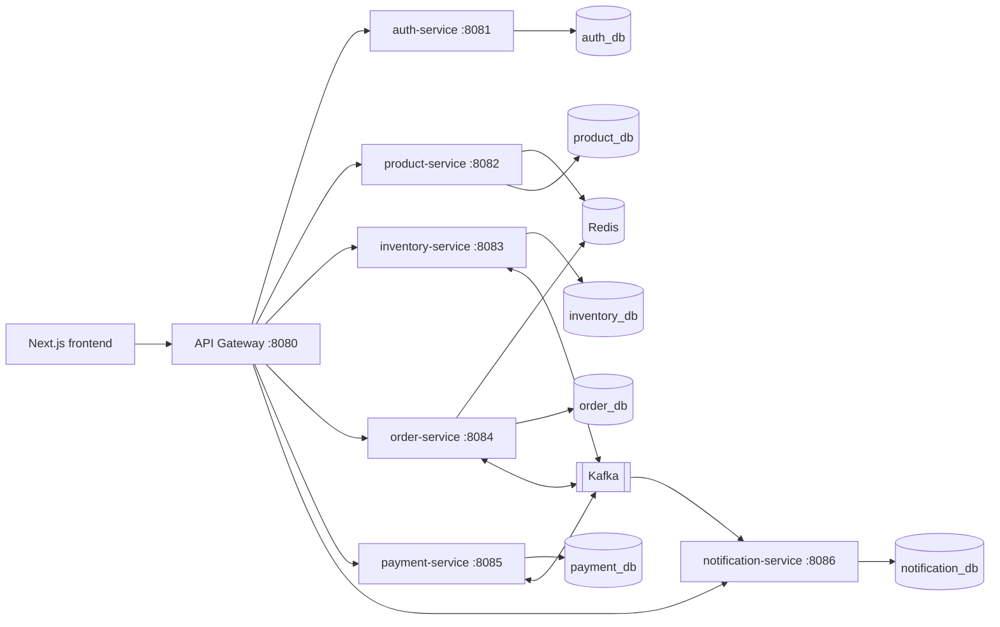
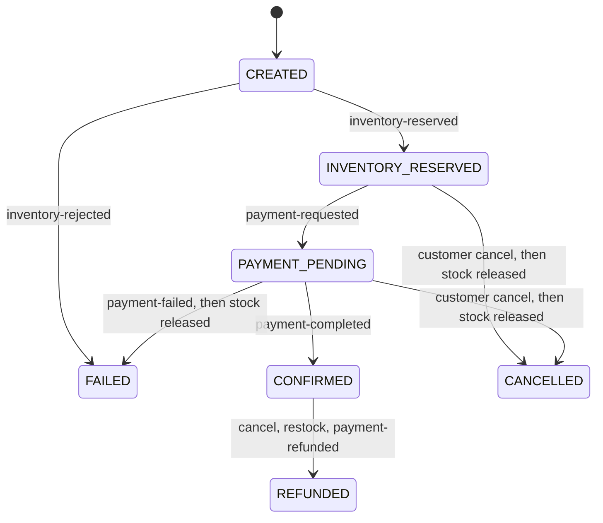

# Architecture

This is the design agreed in Phase 1. Sections marked *planned* are not implemented yet; the
README's status table is the source of truth for what runs today.

## Service boundaries



| Service | Port | Database | Owns |
| --- | --- | --- | --- |
| api-gateway | 8080 | none | Routing, edge JWT check, CORS, error mapping, correlation IDs |
| auth-service | 8081 | `auth_db` | Users, roles, BCrypt hashes, profiles, token issuance |
| product-service | 8082 | `product_db` | Categories, products, search, Redis cache (*planned*) |
| inventory-service | 8083 | `inventory_db` | Stock and reservations (*planned*) |
| order-service | 8084 | `order_db` | Orders, items, saga state, Redis cart (*planned*) |
| payment-service | 8085 | `payment_db` | Simulated charges and refunds (*planned*) |
| notification-service | 8086 | `notification_db` | Mock email history (*planned*) |

Rules:

- One database per service. No cross-database joins or foreign keys. Flyway owns each schema.
- Services never read another service's tables. Data crosses boundaries through REST or Kafka events.
- REST APIs return DTOs, never JPA entities.

## Authentication model

```mermaid
sequenceDiagram
  participant B as Browser
  participant G as API Gateway
  participant A as auth-service
  participant S as Any service
  B->>G: POST /api/auth/login
  G->>A: forward (public route)
  A-->>B: HS256 JWT {sub=userId, email, roles}
  B->>G: GET /api/orders (Authorization: Bearer)
  G->>G: verify signature, expiry, issuer, roles; ADMIN for /api/admin/**
  G->>S: forward with same Authorization + X-Correlation-Id
  S->>S: verify token again, apply resource rules
```

- Tokens are signed with a shared HMAC-SHA256 key from `JWT_SECRET` (at least 32 bytes).
- The gateway rejects bad tokens at the edge. Each service re-validates, so bypassing the
  gateway inside the cluster does not bypass authentication.
- Tokens are stateless. Disabling a user blocks new logins; existing tokens stay valid until
  they expire (default 60 minutes). A denylist or short TTL plus refresh tokens would close
  that window and is a possible later improvement.

## API path conventions

| Prefix | Owner | Access |
| --- | --- | --- |
| `/api/auth/**` | auth-service | Public `register` and `login` |
| `/api/users/me/**` | auth-service | Authenticated user |
| `/api/admin/users/**` | auth-service | ADMIN |
| `/api/products/**`, `/api/categories/**` | product-service | Public GET |
| `/api/admin/products/**`, `/api/admin/categories/**` | product-service | ADMIN |
| `/api/inventory/**`, `/api/admin/inventory/**` | inventory-service | Authenticated / ADMIN |
| `/api/orders/**`, `/api/cart/**`, `/api/admin/orders/**` | order-service | Authenticated / ADMIN |
| `/api/payments/**`, `/api/admin/payments/**` | payment-service | Authenticated / ADMIN |
| `/api/notifications/**`, `/api/admin/notifications/**` | notification-service | Authenticated / ADMIN |

Every admin endpoint lives under `/api/admin/`, so the gateway enforces the ADMIN role with one rule.

## Error contract

Every service and the gateway return the same JSON body:

```json
{
  "timestamp": "2026-11-04T12:41:16.585Z",
  "status": 409,
  "error": "Conflict",
  "code": "EMAIL_ALREADY_REGISTERED",
  "message": "An account with this email already exists",
  "path": "/api/auth/register",
  "correlationId": "b926c686-b85a-432e-a7c0-e75d8702a062",
  "violations": [{ "field": "email", "message": "must be a well-formed email address" }]
}
```

`code` is stable and safe for clients to branch on. `violations` appears only on validation errors.

## Order saga (*planned*, Phases 4–5)

Orchestrated saga. The order service is the only writer of order status. Inventory and payment
are participants. Notification only records messages.



| Topic | Producer | Consumers | Result |
| --- | --- | --- | --- |
| `order-created` | Order | Inventory | Reserve stock |
| `inventory-reserved` | Inventory | Order | `INVENTORY_RESERVED`, then publish payment request |
| `inventory-rejected` | Inventory | Order | `FAILED`; nothing was held |
| `payment-requested` | Order | Payment | `PAYMENT_PENDING`, simulate charge |
| `payment-completed` | Payment | Order, Notification | `CONFIRMED` |
| `payment-failed` | Payment | Order | Start compensation |
| `order-confirmed` | Order | Notification | Confirmation record |
| `order-cancelled` | Order | Inventory, Payment, Notification | Release stock; refund if captured |
| `inventory-released` | Inventory | Order | Lets the order finish `FAILED` or `CANCELLED` |
| `payment-refunded` | Payment | Order | Moves a paid cancellation to `REFUNDED` |

Reliability rules:

- Messages are keyed by `orderId` so one order's events stay ordered within a partition.
- Every event carries `eventId`, `correlationId` (the `orderId`), and `causationId`.
- Consumers insert `eventId` into `processed_events` before side effects; the unique key drops duplicates.
- Producers use a transactional outbox: the event row commits with the business change, and a relay publishes it.
- After retries with backoff, a failing message goes to `<topic>.DLT`.
- Stock is reserved with `UPDATE ... SET available = available - :qty WHERE available >= :qty`.
- A cancel that arrives before the reservation is stored as a tombstone, so a late `order-created` does not reserve stock.
- `POST /api/orders` returns `201` with status `CREATED`; the client polls for the final status.

## Versions

| Component | Version | Note |
| --- | --- | --- |
| Java | 21 | |
| Spring Boot | 3.5.16 | Last 3.x release; OSS support ended June 2026. Boot 4.1 is current but outside this brief. |
| Spring Cloud | 2025.0.3 | Release train for Boot 3.5 |
| Flyway | 11.20.3 | Overrides the Boot-managed 11.7.x for MySQL 8.4 support; same major line |
| springdoc-openapi | 2.8.17 | |
| MySQL | 8.4 LTS | |
